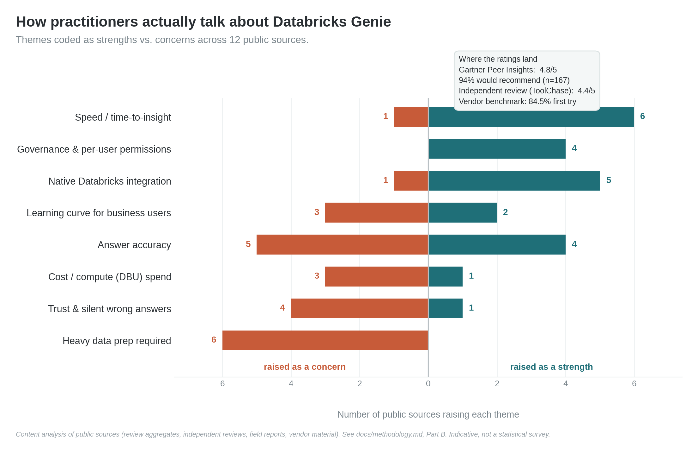

# Genie Reality Check — chart data & methodology

Reproducible data, code, and methodology behind the two charts in the article
**"Is Databricks Genie Ready for Production? A Reality Check."**

Everything is regenerated from the CSVs in [`data/`](data/). Nothing is hand-drawn or hard-coded in prose — run the scripts and you get the same figures and statistics.

## What's here

| Chart | What it shows | Type |
|---|---|---|
| **Perception vs. Reality** | What teams *credit* for Genie's success vs. what *actually* drives it | Conceptual (illustrative) |
| **Practitioner sentiment** | How 12 public sources talk about Genie, coded into 8 themes as strengths vs. concerns | Content analysis |



## Repository structure

```
genie-reality-check/
├── data/                        # source of truth (CSV)
│   ├── perception_vs_reality.csv   # Chart A inputs
│   ├── sentiment_coding.csv        # Chart B: one row per (theme, source, polarity)
│   ├── sources.csv                 # S1–S12 corpus: name, type, vendor flag, URL
│   └── external_figures.csv        # hard ratings used in the chart callout
├── scripts/
│   ├── compute_stats.py            # data -> docs/STATS.md (no deps)
│   ├── perception_vs_reality.py    # data -> figures/perception-vs-reality.png
│   └── practitioner_sentiment.py   # data -> figures/practitioner-sentiment.png
├── figures/                     # generated PNGs (build artifacts)
├── docs/
│   ├── methodology.md              # full method, algorithm, references
│   └── STATS.md                    # generated statistics
├── requirements.txt
└── LICENSE
```

## Reproduce everything

```bash
# 1. (optional) virtual env
python -m venv .venv && source .venv/bin/activate

# 2. install
pip install -r requirements.txt

# 3. regenerate stats + both figures
python scripts/compute_stats.py
python scripts/perception_vs_reality.py
python scripts/practitioner_sentiment.py
```

`compute_stats.py` uses the standard library only; the two chart scripts require `matplotlib`.

## Results at a glance

Practitioner sentiment (net = strengths − concerns, sorted):

| Theme | Strength | Concern | Net |
|---|---:|---:|---:|
| Speed / time-to-insight | 6 | 1 | +5 |
| Native Databricks integration | 5 | 1 | +4 |
| Governance & per-user permissions | 4 | 0 | +4 |
| Answer accuracy | 4 | 5 | −1 |
| Learning curve for business users | 2 | 3 | −1 |
| Cost / compute (DBU) spend | 1 | 3 | −2 |
| Trust & silent wrong answers | 1 | 4 | −3 |
| Heavy data prep required | 0 | 6 | −6 |

23 strengths, 23 concerns across 12 sources. Full working in [`docs/methodology.md`](docs/methodology.md) and [`docs/STATS.md`](docs/STATS.md).

## How to update the analysis

1. Add a source row to `data/sources.csv` (next `S##` code).
2. Add its coded ticks to `data/sentiment_coding.csv` (`theme,source,polarity`).
3. Re-run the three scripts. Stats and figures update automatically.

## Caveats

This is a transparent, reproducible reading of public discussion — **not** a statistical survey.
Single coder, non-random corpus (n=12), no Reddit/LinkedIn, 3 of 12 sources vendor-published.
The Perception vs. Reality chart is a conceptual device, not measured data. See `docs/methodology.md` §Constraints.

## License

Code: MIT (see [`LICENSE`](LICENSE)). Data and documentation: CC BY 4.0 — reuse with attribution.
Sources verified June 2026; Databricks Genie changes frequently, so treat figures as point-in-time.
